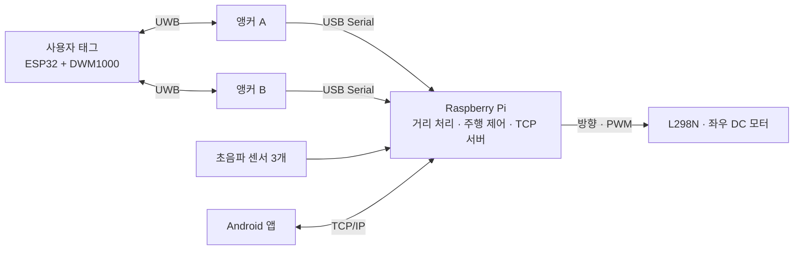

# UWB를 이용한 스마트 카트

**Smart Cart System Using UWB-Based Distance Measurement**

한국공학대학교 전자공학부 · 2026년도 졸업작품

참여자: 박성훈 · 이지현 · 정상현 · 최어진

## 프로젝트 소개

UWB 거리 측정을 기반으로 사용자를 따라 이동하는 스마트 카트를 제작했다. 사용자가 소지한 태그와 카트의 두 앵커 사이 거리를 측정하고, 거리 보정과 모터 제어를 통해 추종 주행을 구현했다. 초음파 센서로 전방 장애물을 감지하며, Android 앱에서 추종 동작과 주행 상태를 관리한다.

**이 저장소는 졸업논문 「UWB를 이용한 스마트 카트」에 해당하는 소프트웨어 구현과 실험 데이터를 정리한 포트폴리오다.** ESP32 펌웨어, Raspberry Pi 제어 프로그램, Android 앱을 기능별로 구분하고, 논문의 설계와 구현 코드를 함께 살펴볼 수 있도록 구성했다.

[졸업논문 및 설계 자료](docs/README.md) · [UWB 펌웨어](firmware/README.md) · [주행 제어](controller/README.md) · [Android 앱](android/README.md) · [실험 데이터](data/README.md)

## 주요 구현

| 구현 영역 | 내용 |
| --- | --- |
| UWB 거리 측정 | ESP32와 DWM1000을 이용한 ADS-TWR 기반 태그–앵커 거리 측정 |
| 신호 처리 | 이동평균, 급격한 거리 변화에 대한 필터 초기화, 앵커별 3차 다항식 보정 |
| 추종 주행 | 두 앵커 기반 중심 거리 추정, 거리별 속도 조절, 거리 차이에 비례한 차동 조향 |
| 장애물 회피 | 초음파 센서 3개를 이용한 감지, 정지·재확인·후진·회전·직진 제어 |
| 모바일 연동 | TCP/IP 기반 추종 명령 전송, 거리 및 동작 상태 표시 |
| 실험 기록 | 정적·동적 거리 측정과 중심 거리 추정 결과를 CSV로 정리 |

## 시스템 구조



태그는 앵커 A와 B를 번갈아 호출하고, 각 앵커는 측정 거리를 Raspberry Pi에 전달한다. Raspberry Pi는 거리 데이터를 처리해 모터를 제어하고, 별도 네트워크 스레드에서 앱의 명령과 상태 메시지를 교환한다.

## 저장소 구성

```text
TUK_UWBsmartcart/
├── README.md                  # 작품 소개 및 소프트웨어 구성
├── firmware/                  # ESP32 · DWM1000 펌웨어
│   ├── 앵커A.c++
│   ├── 앵커B.c++
│   ├── 태그.c++
│   └── README.md
├── controller/                # Raspberry Pi 주행 제어 및 TCP 서버
│   ├── UWB_smartcart_main.py
│   └── README.md
├── android/                   # Android Studio 프로젝트 루트
│   ├── app/src/main/          # Kotlin 소스 · Manifest · 화면 리소스
│   ├── gradle/                # Gradle Wrapper 및 의존성 버전
│   ├── build.gradle.kts
│   ├── settings.gradle.kts
│   └── README.md
├── data/                      # 거리 측정 및 추정 실험 CSV
│   └── README.md
└── docs/                      # 졸업논문 PDF 및 자료 안내
    └── README.md
```

## 논문과 코드 연결

| 논문 내용 | 소프트웨어 구현 | 관련 파일 |
| --- | --- | --- |
| 2.3 통신 시스템 · 2.4 (1) ESP32 Tag/Anchor 펌웨어 | UWB 측정 메시지와 태그·앵커 순차 통신 | [태그](firmware/태그.c++), [앵커 A](firmware/앵커A.c++), [앵커 B](firmware/앵커B.c++) |
| 2.4 (2) 거리 데이터 전처리 · (3) 보정 알고리즘 | 이동평균, 필터 초기화, `cal_A`, `cal_B`, `apply_calibration` | [제어 프로그램](controller/UWB_smartcart_main.py) |
| 2.4 (4) 두 앵커 기반 거리 추정 | `calculate_center_distance` | [거리 처리 설명](controller/README.md#거리-처리와-주행-설정) |
| 2.4 (5) 주행 제어 · (6) 장애물 감지 및 회피 | `drive_proportional`, `avoid_obstacle`, `hardware_thread` | [제어 프로그램](controller/UWB_smartcart_main.py) |
| 앱을 통한 실시간 모니터링 및 제어 | 화면·서비스·소켓 통신 분리, LiveData 기반 상태 표시 | [Android 앱](android/README.md) |
| 2.5 실험 및 결과 분석 | 정적·동적 측정과 중심 거리 추정 결과 | [실험 데이터](data/README.md) |

## 동작 흐름

1. 태그와 두 앵커가 UWB 거리 측정을 수행한다.
2. Raspberry Pi가 시리얼 데이터를 수신하고 필터링·거리 보정을 수행한다.
3. 앱의 `START` 명령에 따라 추종을 시작한다.
4. 중심 거리에 따라 속도를 조절하고, 두 거리의 차이로 좌우 모터 출력을 결정한다.
5. 사용자와의 거리가 0.6 m 미만이면 정지하고, 전방 장애물이 감지되면 회피 동작을 수행한다.
6. 거리와 동작 상태를 앱에 전달한다. 회피 대기는 `RESUME`으로 해제하고 `START`로 추종을 다시 시작한다.

## 개발 환경

| 영역 | 언어 및 주요 기술 |
| --- | --- |
| UWB 펌웨어 | C++, Arduino 기반 ESP32 환경, DW1000Ng, SPI, I²C |
| 중앙 제어 | Python, NumPy, pyserial, RPi.GPIO, threading, queue, socket |
| Android 앱 | Kotlin, AndroidX, LiveData, Foreground Service, TCP Socket |
| 하드웨어 | Raspberry Pi 4 Model B, ESP32, DWM1000, HC-SR04, L298N, JGA25-370 |

## 실행 안내

1. [펌웨어 문서](firmware/README.md)에 따라 태그와 앵커별 스케치를 구성한다.
2. [제어 문서](controller/README.md)에 따라 GPIO와 시리얼 장치를 연결한다.
3. 저장소 루트에서 `python3 controller/UWB_smartcart_main.py`를 실행한다.
4. Android Studio에서 `android/`를 열고 Raspberry Pi의 IP를 설정한다.
5. 앱을 연결하고 거리 및 상태를 확인한 뒤 추종을 시작한다.
